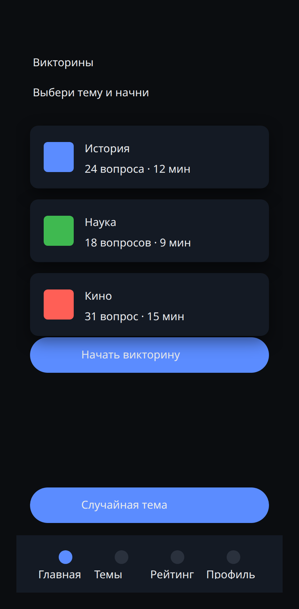
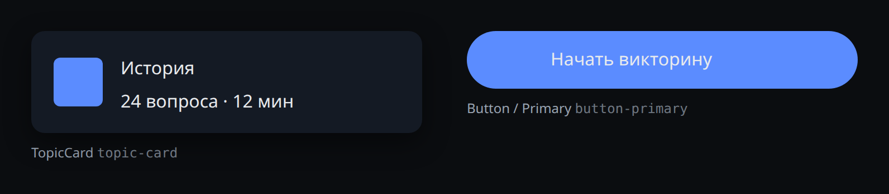

# Design canvas — визуальные макеты для DeepSeek Harness

Плагин даёт две половины одной системы:

- **инструменты агента `design_*`** — агент проектирует интерфейс как код: создаёт
  холсты, собирает экраны батчами операций, объявляет компоненты, ведёт токены,
  проверяет и экспортирует в HTML/CSS;
- **панель «Макеты»** в веб-интерфейсе — Figma-подобный редактор **тех же самых
  файлов**: дерево слоёв, перетаскивание, ресайз, инспектор, библиотека
  компонентов, редактор токенов, экспорт.

Человек и агент работают над одним документом на диске, поэтому дизайн не
расходится между «тем, что нарисовал агент» и «тем, что поправил человек».

## Где лежат макеты

Холсты живут **в репозитории проекта**, а не в домашнем каталоге DSH:

```
<корень проекта>/.design/
  project.json            — метаданные проекта (появляется при первой записи холста)
  home.canvas.json        — документ холста
  settings-mobile.canvas.json
  exports/                — сгенерированные HTML/CSS
    home.html
    home.css
    home.components.html
```

Следствия: дизайн версионируется вместе с кодом, едет в git, переносится между
машинами и лежит рядом с приложением, для которого сделан.

Реестр корней — `~/.dsh/design-canvas.json`. Проекты из таблицы проектов
пользователя (Kendra, QuizForge, Español Vivo, BioPath, Godot-проекты) известны
плагину сразу; каталог с папкой `.design/` плагин находит и сам — и сразу берёт в
реестр, поэтому найденный проект потом адресуется по id (сценарий «клонировали
репозиторий с закоммиченными макетами»). Корзина удалённых холстов —
`~/.dsh/design-trash/` (восстановимо).

## Модель документа

Документ — обычный JSON. Координатная модель Figma-подобная: у каждого узла
абсолютные `x`/`y` относительно родителя и свои `w`/`h`; у фрейма есть режим
`layout.mode` (`none` / `vertical` / `horizontal`), который включает поток и
пересчёт позиций детей. Файл холста `<id>.canvas.json` выглядит так:

```jsonc
{
  "format": "dsh-design-canvas",
  "version": 1,
  "id": "home",
  "name": "Home",
  "device": "mobile",
  "rev": 7,                       // ревизия: поле файла, а не модели документа
  "tokens": { "color": { "bg": "#0b0d10" }, "text": { "h1": { "size": 32, "weight": 700 } } },
  "components": {
    "button-primary": {
      "key": "button-primary",
      "name": "Button / Primary",
      "node": { /* шаблон узла без координат */ },
      "props": {
        "label": { "type": "text", "default": "Кнопка", "target": "text", "property": "text.value" }
      }
    }
  },
  "root": { "id": "root", "type": "frame", "children": [ /* фреймы-экраны */ ] }
}
```

Типы узлов: `frame`, `group`, `rect`, `ellipse`, `line`, `text`, `image`,
`instance`.

`rev` живёт только в файле: `design_read mode=full` и `GET /canvas` возвращают
документ без него, а сама ревизия приходит соседним полем ответа.

Пределы: вложенность — 64 уровня (глубже дети обрезаются), узлов — 20 000,
вложенные инстансы разворачиваются до 32 уровней, холст больше 8 МБ не читается
и не записывается (запись отклоняется, чтобы файл не стал нечитаемым).

### Токены

Значение поля может быть литералом (`#0b0d10`) или ссылкой на токен
(`token:color.bg`). Ссылка разрешается при отрисовке, экспорте и проверке, а в
CSS превращается в переменную: `var(--color-bg, #0b0d10)`. Смена токена
перекрашивает весь макет — и в редакторе, и в собранном HTML.

Единицы вывода берутся из пути токена: `radius.*`, `space.*`, размеры и
межбуквенные интервалы типографики, а также смещения теней получают `px`;
веса и множители строки остаются безразмерными.

Исключение — поле `text.token`: это **голый путь** токена типографики
(`text.h1`, без префикса `token:`), потому что токен составной и описывает
сразу размер, вес, высоту строки и трекинг. Явные `text.size`, `text.weight`,
`text.lineHeight`, `text.letterSpacing` переопределяют значения токена для
конкретного узла.

### Раскладка

`layout.mode = 'none'` — свободное позиционирование: дети сохраняют авторские
`x`/`y`. `vertical` / `horizontal` включает поток: позиции детей выводятся из
порядка, `gap`, `padding`, `align` и `justify`, а размер фрейма подгоняется по
содержимому (отключить можно полями узла `autoW` / `autoH` со значением `false` —
они сохраняются в `canvas.json` и переживают запись).

`justify` (`start` / `center` / `end` / `space-between`) распределяет свободное
место по главной оси, `align: 'stretch'` растягивает детей по поперечной. Свободное
место появляется только у фрейма с авторским размером по этой оси: с включённым
`autoW`/`autoH` фрейм сжимается по содержимому и распределять нечего. Поэтому
`justify: center` работает вместе с `autoW: false` (для горизонтали) и `autoH: false`
(для вертикали), а `align: 'stretch'` — с заданным размером по поперечной оси.
Ту же арифметику повторяет панель, поэтому сохранённый файл совпадает с картинкой.

### Компоненты

**Инстанс — живая ссылка, а не копия.** Своего содержимого у инстанса нет: ключ компонента,
координаты и `overrides`; содержимое разворачивается из шаблона при отрисовке и экспорте, поэтому
правка компонента обновляет все инстансы сразу. Авторские дети инстанса не отрисовываются и не
экспортируются, а `design_validate` сообщает о них замечанием `instance-children`.
`design_components action=detach` (или `op: detach`) превращает инстанс в
обычный узел.

Переопределения инстанса бывают двух видов:

- объявленный параметр компонента — значение ложится в `property`-путь узла-цели
  `target` (`root`, `#Имя узла`, `text` или путь внутри шаблона —
  `children[0].label`);
- произвольный путь узла (`style.fill`, `text.value`, `w`) — точечная правка без
  объявления параметра.

При объявлении компонента параметр `label` выводится автоматически из первого
текстового узла.

## Инструменты агента

| Инструмент | Назначение |
|---|---|
| `design_projects` | реестр проектов и холстов; `init` — инициализировать каталог как проект |
| `design_create` | создать холст (устройство, шаблон, сразу батч операций) |
| `design_read` | проекции холста: `summary`, `outline`, `node`, `tokens`, `components`, `full` |
| `design_apply` | **основной инструмент**: батч операций, транзакционно |
| `design_tokens` | чтение и правка палитры, типографики, радиусов, отступов, теней |
| `design_components` | `list` / `get` / `define` / `instantiate` / `detach` / `delete` |
| `design_export` | HTML + CSS + страница библиотеки компонентов в `.design/exports/` |
| `design_validate` | дубли id, битые инстансы, авторские дети инстанса, отсутствующие токены, обрезка, контраст (порог по размеру текста, токены и `rgba()` считаются) |
| `design_delete` | корзина: `list` / `delete` / `restore` |

### Операции `design_apply`

| Операция | Поля |
|---|---|
| `add` | `{ parent, node \| type, index?, after? }` — занятый `id` заменяется новым, ответ возвращает фактический |
| `update` | `{ id \| ids, patch }` — `x`, `y`, `w`, `h`, `name`, `visible`, `locked`, `style.*`, `text.*`, `layout.*` |
| `move` | `{ id, parent?, index?, after? }` — `after`: id соседа, за которым вставить; без `parent` узел остаётся у того же родителя и меняет порядок |
| `delete` | `{ id \| ids }` |
| `duplicate` | `{ id \| ids, count?, offsetX?, offsetY?, parent? }` |
| `group` / `ungroup` | `{ ids, name? }` / `{ id }` |
| `reorder` | `{ id, index \| direction }`, direction: `front` / `back` / `up` / `down` |
| `set-tokens` | `{ tokens, remove?, replace? }` — `remove` удаляет пути (`color.bg`, `text.h1.size`) |
| `define-component` | `{ key, from, name?, description?, props?, convert? }` |
| `delete-component` | `{ key, detach? }` |
| `instantiate` | `{ component, parent, x?, y?, w?, h?, name?, overrides?, index?, after? }` |
| `detach` | `{ id }` |
| `set-canvas` | `{ name?, device? }` — `mobile` / `tablet` / `desktop` / `component`; неизвестное значение — ошибка |
| `align` | `{ ids, mode, axis? }` — `mode`: `left` / `center` / `right` / `top` / `middle` / `bottom`; `axis` задаёт ось (`x` / `y`) вместо выведенной из `mode`, противоречие `axis` и `mode` — ошибка |
| `distribute` | `{ ids, axis? }` — `x` / `y` (по умолчанию `x`), минимум три узла |

Батч транзакционный: ошибка в любой операции откатывает весь батч, документ
остаётся прежним. Ревизия растёт на 1; `expectRev` защищает от затирания правок,
сделанных в панели (несовпадение → отказ 409).

Фрейм, добавленный операцией `add`, по умолчанию обрезает детей (`clip: true`),
как фрейм из шаблона устройства; `clip: false` делает контейнер прозрачным.

### Пример: экран одним вызовом

```jsonc
// design_create { "project": "quizforge", "canvas": "quiz-home", "device": "mobile" }
// design_apply
{
  "project": "quizforge",
  "canvas": "quiz-home",
  "ops": [
    { "op": "add", "parent": "page", "node": {
        "id": "header", "type": "frame", "name": "Header",
        "x": 0, "y": 0, "w": 390, "h": 88,
        "style": { "fill": "token:color.surface" } } },
    { "op": "add", "parent": "header", "node": {
        "id": "title", "type": "text", "name": "Title",
        "x": 20, "y": 32, "w": 300, "h": 32,
        "text": { "value": "Викторины", "token": "text.h1", "color": "token:color.fg" } } },
    { "op": "add", "parent": "page", "node": {
        "id": "cta", "type": "frame", "name": "CTA",
        "x": 20, "y": 120, "w": 350, "h": 52,
        "style": { "fill": "token:color.accent", "radius": "token:radius.pill" },
        "layout": { "mode": "horizontal", "align": "center", "justify": "center" } } },
    { "op": "add", "parent": "cta", "node": {
        "type": "text", "name": "CTALabel", "x": 0, "y": 0, "w": 200, "h": 24,
        "text": { "value": "Начать", "color": "token:color.accentFg", "align": "center" } } },
    { "op": "define-component", "key": "button-primary", "from": "cta", "name": "Button / Primary" },
    { "op": "instantiate", "component": "button-primary", "parent": "page",
      "x": 20, "y": 190, "overrides": { "label": "Мои результаты" } }
  ]
}
```

## Экспорт

`design_export` пишет в `<проект>/.design/exports/`:

- `<canvas>.html` — страница со всеми фреймами;
- `<canvas>.css` — токены как `:root { --color-bg: … }` плюс базовые классы;
- `<canvas>.components.html` — библиотека: каждый компонент один раз.

Верхние фреймы холста — экраны: на собранной странице они всегда встают потоком
доски (`.dc-board`), поэтому два экрана, поставленные в одну точку `(0,0)`, не
накладываются друг на друга. Режим решает, как позиционируются узлы внутри:

- `fidelity` — абсолютное позиционирование узлов **внутри** фреймов, пиксельно
  точно (превью, handoff); верхние фреймы и здесь встают потоком доски, поэтому их
  координаты в собранной странице не сохраняются;
- `clean` — фреймы с `layout.mode` становятся flex-контейнерами, остальное
  абсолютное (ближе к вёрстке приложения).

У каждого элемента есть `data-node="<id узла>"` — DOM можно связать с макетом.

## Панель «Макеты»

Иконка в левой колонке веб-интерфейса. Внутри: тулбар инструментов (select,
frame, rect, ellipse, text), панели «Холсты / Слои / Компоненты / Токены»,
вьюпорт с pan/zoom, инспектор, автосохранение с разрешением конфликтов ревизий,
undo/redo, экспорт и проверка. Узлы `line` и `image` из тулбара не создаются —
их ставит агент операцией `add`.

## HTTP-маршрут

`/api/dsh-design-canvas` — тот же `service.js`, что и у инструментов агента.
Основное:

```
GET  /projects?canvases=1        GET  /canvases?project=
GET  /display?project=&id=       GET  /canvas?project=&id=&mode=full
GET  /outline|tokens|components|validate|export|trash|config
POST /create | /init | /apply | /canvas | /tokens | /components | /export | /delete | /restore
```

`GET /display` отдаёт готовое дерево для отрисовки: все инстансы развёрнуты
сервером, дети инстанса неймспейснуты его id (`<instanceId>/<childId>`) — так
правила разворачивания компонентов живут в одном месте и не дублируются на
клиенте.

Дефолты адаптеров различаются: `design_read` читает `summary`, `GET /canvas` —
`full`; `GET /export` всегда отдаёт превью со встроенным CSS и файлов не пишет.

## Архитектура

| Файл | Слой |
|---|---|
| `schema.js` | модель: нормализация, обход дерева, токены, компоненты, валидация |
| `store.js` | файлы: реестр проектов, `.design/`, ревизии, корзина |
| `ops.js` | операции над документом (транзакционный движок) |
| `export.js` | генерация HTML/CSS |
| `service.js` | сценарии: одна логика для агента и панели |
| `tools.js` | 9 инструментов агента (тонкие адаптеры) |
| `route.js` | HTTP-маршрут панели (тонкий адаптер) |
| `index.js` | точка входа плагина: инструменты + маршрут |
| `client.js` | визуальный редактор (React без JSX) |

Правило: логика живёт в `schema/store/ops/export/service`, а `tools.js` и
`route.js` только разбирают аргументы и рендерят результат.

## Демо

`node demo.mjs` собирает холст `demo/.design/quiz-home.canvas.json` — экран
приложения с токенами, компонентом `topic-card` (три инстанса с разными
переопределениями) и потоковой нижней навигацией. Он же служит фикстурой для
проверки панели.

| Экран | Библиотека компонентов |
|---|---|
|  |  |

Превью снимаются с того же экспорта: `npm run demo && npm run preview`.
`npm run demo` пересобирает только `demo/.design/`, поэтому готовые превью
уцелевают; `npm run preview` нужен, когда изменился сам демо-холст или экспорт.
Снимок самой панели «Макеты» делает живой прогон — `DSH_WEB_TOKEN=… node smoke-gui.mjs … .gui-shot.png`.

## Проверки

```bash
cd ~/dsh-plugins/dsh-design-canvas
npm run check             # синтаксис всех .js/.mjs
npm test                  # ядро + инструменты и маршрут + контракт клиента
DSH_WEB_TOKEN=<токен из адресной строки> \
  node smoke-gui.mjs http://127.0.0.1:3080 .gui-shot.png   # панель в живом DSH
```

- `smoke.mjs` — схема, хранилище, операции, транзакционность, экспорт, защита путей;
- `smoke-tools.mjs` — регистрация 9 инструментов и полный цикл через HTTP-маршрут;
- `smoke-client.mjs` — контракт браузерного модуля: слоты, словари, маршруты API, отсутствие JSX;
- `smoke-gui.mjs` — открывает панель в живом DSH и снимает скриншот, собирая ошибки консоли.
  Ему нужны запущенный DSH, токен и собранная демо-фикстура (`npm run demo`).

## Разработка

- `AGENTS.md` — правила проекта для агента: слои, инварианты, команды, критерии сдачи;
- `docs/ARCHITECTURE.md` — внутреннее устройство: слои, модель, рецепты расширения, коды ошибок;
- `docs/BACKLOG.md` — известные дефекты и долги с уровнем доказанности;
- `.dsh/skills/` — скилы проекта, которые DSH подхватывает автоматически;
- `agency/` — эксперты и команда The Agency для разработки плагина
  (`npm run agency:check`, затем `node tools/agency-sync.mjs`).

## Установка и обновление

Плагин подключён как `link:` в `~/.dsh/profiles/web/package.json` и перечислен в
`dsh.profile.bundles`. Правки Host-половины подхватываются после перезапуска
`dsh web`; клиентская половина перезагружается обновлением страницы (а при
запущенном `pnpm run dev:web` — на лету).
